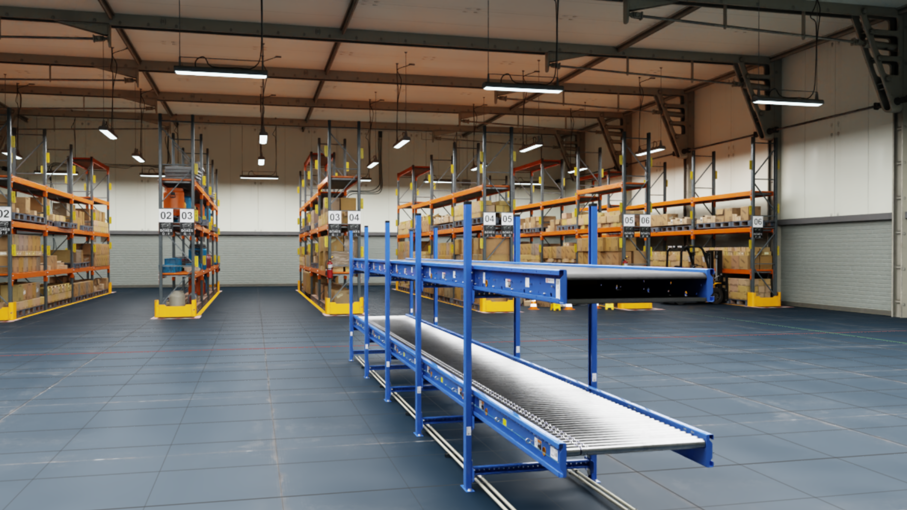
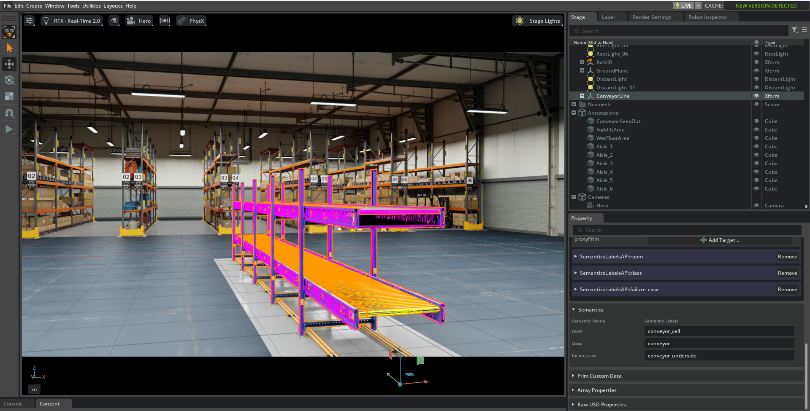
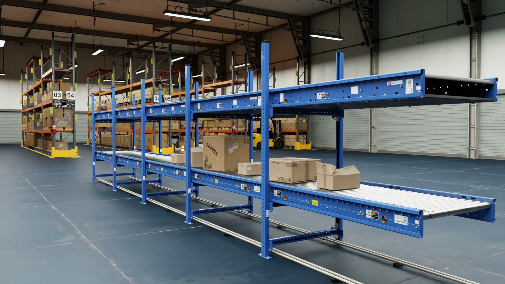

# USD scene annotation for Isaac Sim

Python tools that take a 3D scene built by someone else and make it ready for robot simulation in NVIDIA Isaac Sim: semantic labels, a collision decision on every piece of geometry, moving conveyors, and the spots where robots tend to fail, labeled and measured. One JSON config per scene drives it, and a QA note checks the result.



## The problem

A scene from a 3D artist or an asset library looks right but isn't ready for simulation:

- **No semantic labels.** Perception training data (segmentation, bounding boxes) and scenario tests need every object labeled with a fixed vocabulary. Object names chosen by an artist (`SM_PaletteA_252`, `Box_1203`) aren't labels.
- **Colliders are incomplete or unsuited.** Some geometry has none, some has detailed visual meshes that would slow physics or catch objects, and some should not collide at all.
- **Moving equipment is static.** A conveyor in a scene file is just a mesh. Nothing moves on it.
- **Nobody has listed where robots fail:** overhangs a 2D lidar can't see, obstacles below its scan height, keep-out areas, aisle widths. Those are what a navigation test needs.

Doing this by hand on thousands of prims is slow, inconsistent, and has to be redone each time the scene changes.

## What the pipeline does

`annotate.py` applies a config to a scene and writes everything into a separate layer. **The original scene files are never modified.**

- **Zone labels** (`semantics:labels:room`), from prim paths or from floor rectangles for scenes with no room structure, such as a warehouse.
- **Object class labels** (`semantics:labels:class`): pallet, box, rack, traffic cone… set by path rules. The QA note lists any geometry left without a class.
- **A collision decision on every geometry prim.** Colliders the scene already has are kept as authored. Geometry without one gets a collider. Listed prims are set not collidable: visual meshes whose collision comes from simpler proxy shapes, or things a robot should ignore.
- **Moving surfaces:** conveyor rollers become kinematic bodies with a PhysX surface velocity, so boxes placed on them are carried along.
- **Failure cases,** with the category list set per site (`semantics:labels:failure_case` plus `annotation:*` attributes). Heights, clearances and gap widths are **measured from the geometry**, never typed in.
- **Review cameras** saved in the scene, so anyone can return to the same viewpoints.
- **A QA note** per scene: collider counts, labels, categories present or absent, measurements, conveyor speeds, and pass/fail checks.

## Example: NVIDIA warehouse with a conveyor line

The scene is NVIDIA's `full_warehouse` from the Isaac Sim 6.2 assets: 3,148 objects with no zones or labels. A 10 m roller conveyor line (five `ConveyorBelt_A04` sections) was added with `make_line.py`. The config is [configs/warehouse.json](configs/warehouse.json).



*The same view in Isaac Sim: the conveyor's colliders (the moving rollers in yellow), the conveyor keep-out zone, the prims the pipeline added (`/Annotations`, `/Cameras`), and the three labels on the conveyor.*

[](media/conveyor_drop.mp4)

*15 s simulation in Isaac Sim (click the image to open the video): six of the warehouse's box models dropped onto the rollers, carried toward the racks at 0.3 m/s.*

**Result** (from the QA note):

| | |
|---|---|
| Geometry prims | 3,809, all with a collision decision |
| Colliders | 3,658 kept from NVIDIA, 1 added, 150 set not collidable (conveyor frame, stickers and drive bands, covered by NVIDIA's proxy shapes) |
| Zones | `storage`, `open_floor`, `conveyor_cell` |
| Object classes | 27 classes, 0 geometry prims without a class |
| Moving surfaces | 5 roller beds at 0.3 m/s |
| Failure-case categories | 6 of 7 present; `ramps_dock_plates` checked and absent |

Some of the measurements:

| Failure case | Measured |
|---|---|
| Free height under the conveyor (to its collision side wall) | 0.589 m |
| Free height under the lowest rack shelves (28 shelves) | 0.955 m |
| Fire extinguishers and an emergency board sticking out from walls and racks | bottom edge at 0.92-1.13 m |
| Flat plastic bottles in the cluttered aisle, below a typical 2D lidar plane | 0.061 m tall |
| Clear width of the 6 rack aisles, at their narrowest point | 3.594-3.791 m |

The aisles are 3.95 m between rack frames, but pallets, boxes sticking out and the rack-end guards narrow them by up to 36 cm. The measured width is the one a robot actually has.

## How it was checked

- **Automated QA** ([qa_check.py](qa_check.py)): every geometry prim has a collision decision, zone labels exist, every moving surface is a kinematic body, and every measurement is a finite, plausible number. It exits with code 1 on failure. The last check was added after a real bug got through: measuring to NVIDIA's collision shapes (purpose `proxy`) returned an empty bounding box, and QA passed with an impossible clearance until the value was spotted in its output.
- **Labels checked by eye.** QA can tell that a label is present, not that it's right. Uncertain class rules were checked in Isaac Sim before use: `SM_RackPile` turned out to be stacked rack uprights, not boxes, and got its own class.
- **Measurements cross-checked:** the conveyor clearance against the mesh's own vertex heights, and aisle widths against the rack layout.
- **In Isaac Sim 6.2:** labels in the Semantics panel, colliders in the physics debug view, and the drop test in the video.

## Use-case assumptions

Several values depend on the client's robots and site: keep-out margins, conveyor speed and direction, which objects count as obstacles, how detailed the classes are. They are listed with the reason for each choice and what would change it in [configs/warehouse_assumptions.md](configs/warehouse_assumptions.md). Robot height, lidar height and vehicle widths are left open on purpose: the pipeline measures clearances, heights and widths, and a test compares them with its own robot.

## Run it

### Setup

Tested with Isaac Sim 6.2 on Windows. Isaac Sim's `python.bat` can't import `pxr` outside the app, so `isaac_python.bat` sets the paths to the USD libraries Isaac Sim ships:

```bat
set ISAAC_SIM=C:\path\to\isaac-sim-standalone-6.2.0-windows-x86_64
isaac_python.bat inspect_scene.py some_scene.usd
```

The scripts only need OpenUSD (`pxr`), so another OpenUSD 24.08+ Python install should also work, but that hasn't been tested.

### Warehouse example

The scene files aren't in this repository. They are NVIDIA Isaac Sim assets (CC BY 4.0) on the Isaac Sim 6.2 asset server, `https://omniverse-content-production.s3-us-west-2.amazonaws.com/Assets/Isaac/6.2/`:

- `Isaac/Environments/Simple_Warehouse/full_warehouse.usd`
- `Isaac/Props/Conveyors/ConveyorBelt_A04.usd`

To get local copies with all props and textures: in Isaac Sim's Content tab, right-click each file, choose **Collect As…** with every option unchecked, and collect into `scenes/full_warehouse` and `scenes/conveyor_A04` (git ignores `scenes/`).

```bat
isaac_python.bat make_line.py scenes/full_warehouse/full_warehouse.usd scenes/conveyor_A04/ConveyorBelt_A04.usd -o scenes/warehouse_line.usda --start -11 -12 --yaw 90 --count 5
isaac_python.bat inspect_scene.py scenes/warehouse_line.usda --summary
isaac_python.bat annotate.py scenes/warehouse_line.usda configs/warehouse.json -o out/warehouse_annotated.usda
isaac_python.bat qa_check.py out/warehouse_annotated.usda -o out/warehouse_qa_note.md
```

Then open `out/warehouse_annotated.usda` in Isaac Sim:

1. Pick a camera in the viewport camera menu: **Cameras > Hero** or **Line**.
2. Select an object: its labels are in the Property panel under **Semantics**.
3. Show colliders: viewport eye menu > Show By Type > Physics > Colliders.
4. Drop test: run [drop_boxes.py](drop_boxes.py) in **Window > Script Editor**, then press Play. Don't save the stage afterwards (the boxes would end up in the annotation layer).

Menu names can differ slightly between Isaac Sim versions.

### Test apartment (residential, no download)

A small generated apartment with residential failure cases (door threshold, rug, low bed and table, cable, floor vent, mirror). Its results are committed in `out/`.

```bat
isaac_python.bat make_test_room.py test_scene/apartment.usda
isaac_python.bat annotate.py test_scene/apartment.usda configs/apartment.json -o out/apartment_annotated.usda --flatten
isaac_python.bat qa_check.py out/apartment_annotated_flat.usda -o out/apartment_qa_note.md
```

## Config format

```json
{
  "root": "/Root",
  "categories": ["moving_surfaces", "keep_out_zones", "low_clearance", "small_obstacles"],
  "rooms": {
    "living_room":   ["/Apartment/LivingRoom"],
    "conveyor_cell": [{"box": [[-14, -14], [-8, 0]]}]
  },
  "classes":          {"/Root/SM_PaletteA*": "pallet", "/Apartment/LivingRoom/Chair_*": "chair"},
  "non_collidable":   ["/Apartment/LivingRoom/Cable", "/Root/ConveyorLine/*/Conveyor/Rubberbands"],
  "surface_velocity": {"/Root/ConveyorLine/*/Conveyor/Rollers": [0.3, 0.0, 0.0]},
  "surfaces":         {"/Root/SM_floor*": "hard_glossy"},
  "features": [
    {"category": "low_clearance", "prim": "/Apartment/Bedroom/Bed",
     "underside": "/Apartment/Bedroom/Bed/Frame", "type": "bed", "measure": ["clearance"]},
    {"category": "small_obstacles", "prim": "/Root/S_TrafficCone*", "type": "traffic_cone", "measure": ["height"]},
    {"category": "keep_out_zones", "type": "conveyor_keep_out",
     "marker": {"name": "ConveyorKeepOut", "center": [-11.0, -7.0, 0.0], "size": [2.2, 11.0, 0.01]},
     "attributes": {"margin_m": 0.5}}
  ],
  "cameras": {
    "Hero": {"translate": [-13.2, -16.4, 1.9], "rotate_xyz": [89.3, 0.0, -13.9], "focal_length": 18.15}
  }
}
```

- `categories`: the failure-case list for this site. If it's left out, the residential list is used.
- `rooms`: each entry is a prim path, or a floor rectangle `{"box": [[xmin, ymin], [xmax, ymax]]}` in meters. A rectangle labels every direct child of `root` whose footprint center lies inside it.
- `classes`, `non_collidable`, `surface_velocity`, `surfaces`, and a feature's `prim`: a path, a pattern with `*`, or (for `prim`) a list. A path also covers everything below it.
- `classes`: rules apply in order, so a later rule can override an earlier one. Names are only a starting point: check the result in Isaac Sim.
- `features`: each match gets `annotation:category`, `annotation:type` and a `semantics:labels:failure_case` label, kept separate from the object's class.
- `measure`: `height`, `clearance` (bottom of `underside` above `floor_level_m`, so legs don't count), `gap` (needs `between: [a, b]`).
- `marker`: for a feature that isn't its own prim (a keep-out area, an aisle). Creates an invisible guide box under `/Annotations`, in meters.
- `surface_velocity`: velocity in m/s, in the prim's local frame.
- `cameras`: review viewpoints under `/Cameras`, in meters and degrees.
- `attributes`: any extra values, e.g. a margin and its basis. Written as `annotation:<name>`.

## Files

| File | Purpose |
|---|---|
| [annotate.py](annotate.py) | Applies a config: labels, collision, moving surfaces, failure cases, measurements, cameras |
| [qa_check.py](qa_check.py) | Checks the result and writes the QA note |
| [inspect_scene.py](inspect_scene.py) | Prints the prim tree with sizes and positions. `--summary` groups a large flat scene's objects by name, with counts, sizes and heights |
| [make_line.py](make_line.py) | Places a straight conveyor line in an environment, as a small file referencing both |
| [drop_boxes.py](drop_boxes.py) | Drop demo, run in Isaac Sim's Script Editor |
| [make_test_room.py](make_test_room.py) | Builds the test apartment |
| [isaac_python.bat](isaac_python.bat) | Runs a script with Isaac Sim's Python and USD libraries (Windows) |
| [configs/](configs/) | Configs for the warehouse and the test apartment, and the warehouse's use-case assumptions |
| [media/](media/) | The images and video above |

## Limits

- Colliders that already exist are kept, not validated: their shapes are the scene author's choice.
- In the warehouse, the 6.8 cm floor bar under the conveyor has no collider (NVIDIA's proxy shapes don't include it). The keep-out zone covers that area.
- The wet-floor area is a label only: no puddle is rendered and floor grip is unchanged.
- Each aisle's width is measured between the pair of objects that was narrowest when the config was written. If pallets are moved, the config needs updating.
- The surface velocity attributes (`PhysxSurfaceVelocityAPI`) are written by hand, so the scripts don't need the PhysX schema package.
- Custom USD attributes don't survive a plain glTF export. For a glTF deliverable, the `annotation:*` values would need to be copied into each node's glTF `extras`. That isn't implemented here.

## Credits

Warehouse, conveyor and box assets: NVIDIA Isaac Sim, CC BY 4.0. Everything in this repository was written for this project.
